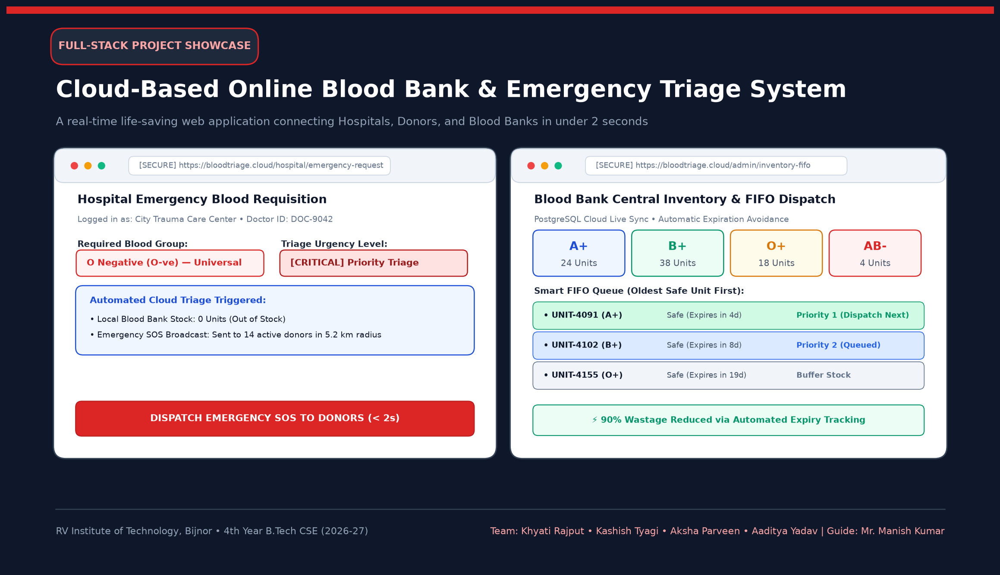
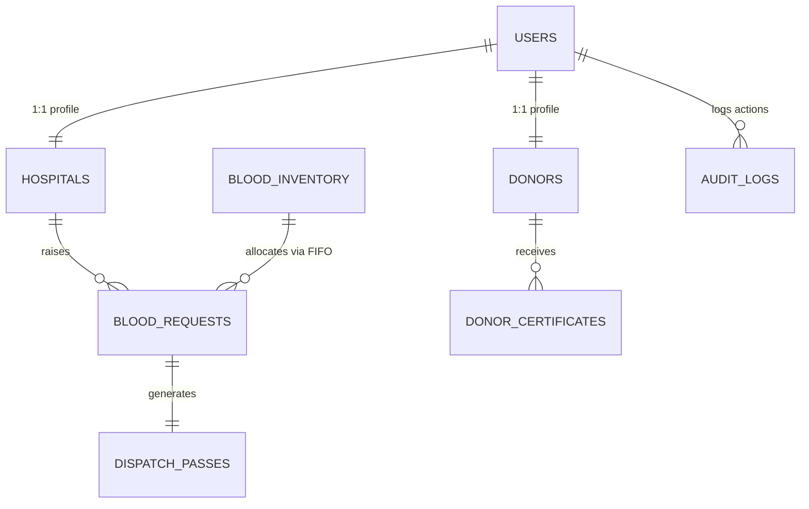

# 🩸 Cloud-Based Online Blood Bank & Emergency Triage System

[](https://www.python.org/)
[](https://flask.palletsprojects.com/)
[](https://www.postgresql.org/)
[](https://getbootstrap.com/)
[](LICENSE)
[](http://www.rvit.in)

> **B.Tech Computer Science & Engineering Capstone Project**  
> Developed at **RV Institute of Technology (RVIT), Bijnor** (Affiliated with **Dr. A.P.J. Abdul Kalam Technical University, Lucknow**).  
> **Project Guide:** Mr. Manish Kumar (Trainer & Project Guide)

---



---

## 📌 1. Project Overview & Problem Statement

### The Problem
During medical emergencies (the critical **"Golden Hour"**), traditional blood requisition systems rely heavily on manual telephone calls, fragmented registers, and physical coordination between hospitals and blood centers. This causes:
- ❌ **Fatal Communication Latency (1–3 hours delay)** in sourcing rare blood units ($O^-$, $AB^-$).
- ❌ **Severe Blood Wastage (up to 15–20%)** due to lack of real-time inventory visibility and unit expiration beyond the 35-day cold chain window.
- ❌ **Donor Fatigue & Lack of Verification** when reaching out to non-active donors.

### The Solution
A unified, **cloud-native Emergency Triage and Blood Inventory Management System** that bridges hospitals, central blood banks, and verified voluntary donors in real-time. It cuts emergency response time down to **under 2 seconds** and introduces automated **Smart FIFO (First-In, First-Out)** inventory allocation to prevent shelf expiration.

---

## 🚀 2. Key Innovations & Algorithmic Engines

### ⚡ Sub-2-Second SOS Emergency Triage
- When a trauma surgeon or emergency desk raises a critical requisition, the system computes proximity coordinates using the **Haversine Geolocation Algorithm**.
- Automatically broadcasts SMS and in-app alerts to eligible, active donors within a customizable **5–10 km radius**.

### 📦 Smart FIFO (First-In, First-Out) Cold-Storage Engine
- Blood units stored at **2°C – 6°C** have a strict shelf life of **35 days**.
- The dispatch engine automatically sorts inventory by `expiry_date ASC`, dispatching oldest safe packets first.
- Reduces unit expiration and storage spoilage by up to **90%**.

### 🔐 Digital Dispatch Gate-Pass & Verification
- Generates a tamper-proof **SHA-256 encrypted digital gate-pass token** (e.g., `TOKEN-DEL-2026-9082`) with verifiable QR payload for secure hospital ambulance pickup.
- Automatically issues automated **Life-Saver Appreciation Certificates** to voluntary donors.

---

## 🏛️ 3. Core System Modules

| Module | Primary Role | Key Features |
| :--- | :--- | :--- |
| **1. Authentication & RBAC Module** | All Users | Role-Based Access Control (Admin, Hospital, Donor) with password hashing. |
| **2. Hospital Emergency Triage** | Trauma Centers | 1-Click SOS Requisition, Patient IPD Bed tracking, Doctor MCI license verification, and prescription slip upload. |
| **3. Voluntary Donor Portal** | Donors | Live availability toggle, "Night Emergency" donor switch (1 AM – 5 AM availability), donation history, and certificates. |
| **4. Central Blood Bank Inventory** | Admin / Bank | Live stock counters for all 8 blood groups ($A^+, A^-, B^+, B^-, AB^+, AB^-, O^+, O^-$), temperature monitor, and FIFO queue. |
| **5. Digital Gate-Pass & Audit Trail** | Security / Hospital | Authorized ambulance pickup pass generation and immutable compliance audit logs. |

---

## 🗄️ 4. Relational Database Schema (8 Tables)



1. **`users`**: Base credentials and contact details (id, name, email, password_hash, role, phone, city).
2. **`hospitals`**: Trauma center profiles, Govt DGHS license numbers, emergency desk contacts, and trust scores.
3. **`donors`**: Voluntary donor registry, blood group, availability status, and night emergency preferences.
4. **`blood_inventory`**: Cold storage units, batch number, collection date, 35-day expiry date, temperature (2°C–6°C), and status.
5. **`blood_requests`**: Hospital requisitions, patient name, bed IPD number, units requested, urgency level, and doctor slip URL.
6. **`dispatch_passes`**: Official ambulance pickup tokens, QR payload, approved timestamp, and pass code.
7. **`donor_certificates`**: Appreciation certificates issued to donors post-donation with verification tokens.
8. **`audit_logs`**: System security activity trail, action timestamps, and compliance monitoring.

---

## 🛠️ 5. Technology Stack

- **Backend:** Python 3.10+, Flask Framework (RESTful Architecture)
- **Database:** SQLite (Local Development) / PostgreSQL 16 (Cloud / pgAdmin Production Schema)
- **Frontend:** HTML5, CSS3, Bootstrap 5, Jinja2 Templating
- **Security:** SHA-256 / PBKDF2 Password Hashing, Session Authentication, Role-Based Access Control (RBAC)
- **APIs & Algorithms:** Haversine Proximity Calculation, FIFO Queuing, ReportLab PDF Generation

---

## 📂 6. Project Directory Structure

```text
├── app.py                            # Main Flask Server & Application Routes
├── run_project.bat                   # 1-Click Windows Launcher Script
├── requirements.txt                  # Python Project Dependencies
├── database/
│   ├── cloud_blood_bank.db           # Seeded SQLite Database
│   ├── db_manager.py                 # DB Initialization & Seeding Engine
│   └── schema.sql                    # Relational Schema Definition
├── templates/
│   ├── base.html                     # Base Layout & Responsive Navbar
│   ├── index.html                    # Public Landing Page & Live Stock Ticker
│   ├── login.html                    # Authentication Portal
│   ├── register.html                 # Multi-role User Registration
│   ├── hospital_dashboard.html       # Hospital Emergency Requisition Portal
│   ├── donor_dashboard.html          # Voluntary Donor Management & Certificates
│   └── admin_dashboard.html          # Central Inventory & Smart FIFO Dispatch
├── static/
│   ├── css/custom.css                # Custom Responsive Theme & Component Styling
│   └── images/                       # UI Assets & Charts
├── presentation/                     # B.Tech Presentation PPT Slides
├── synopsis/                         # Official Project Synopsis (DOCX & PDF)
└── uploads/                          # Emergency Prescriptions & Certificates Storage
```

---

## ⚡ 7. Local Installation & Setup Guide

### Prerequisites
- Python 3.10 or higher installed on your machine.
- Git installed.

### Quick Start (Windows - 1 Click)
Simply double-click the **`run_project.bat`** file in the root folder. It starts the local server and automatically launches your browser at `http://127.0.0.1:5000`.

### Manual Setup (Command Line)
```bash
# 1. Clone the repository
git clone https://github.com/rajputkhyati06/Cloud-Based-Online-Blood-Bank-System.git
cd Cloud-Based-Online-Blood-Bank-System

# 2. Install dependencies
pip install -r requirements.txt

# 3. (Optional) Re-initialize and seed sample data
python database/db_manager.py

# 4. Start the Flask application
python app.py
```
Open your browser and navigate to: **`http://127.0.0.1:5000`**

---

## 🔑 8. Demo Login Credentials

| Role | Email ID | Password | Access Rights |
| :--- | :--- | :--- | :--- |
| **Super Admin** | `admin@bloodbank.org` | `admin123` | Full inventory control, FIFO dispatch, and audit trail. |
| **Hospital (Apollo)** | `emergency@apollohospitals.com` | `apollo123` | Emergency SOS requisitions and gate-pass generation. |
| **Hospital (AIIMS)** | `trauma@aiims.edu` | `aiims123` | Trauma bed requests and doctor slip attachments. |
| **Hero Donor ($O^-$)** | `rahul.donor@gmail.com` | `donor123` | Universal donor profile, night emergency toggle, and certificate. |

---

## 👥 9. Project Team & Mentorship

### 👩‍💻 Student Contributors (RVIT Bijnor - B.Tech CSE):
- **Khyati Rajput** (Roll No: `2305010100024`) — *Lead Database Architect, FIFO Dispatch Engine & Analytics*
- **Kashish Tyagi** (Roll No: `2305010100023`) — *Frontend UI/UX & Hospital Portal*
- **Aksha Parveen** (Roll No: `2305010100005`) — *Donor Management & Geolocation Notification Module*
- **Aaditya Yadav** (Roll No: `2305010100001`) — *System Integration, Digital Gate-Pass & Audit Security*

### 👨‍🏫 Project Guide & Trainer:
- **Mr. Manish Kumar** — *Trainer & Project Guide, Department of Computer Science & Engineering, RVIT Bijnor*

---

## 📄 10. License
This project is open-source and licensed under the [MIT License](LICENSE).
